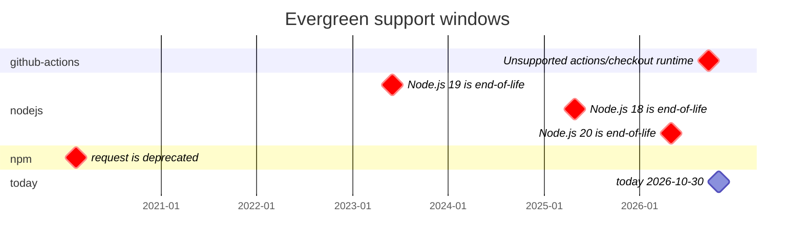

# Showcase

Short, copy-pasteable ways to show what Evergreen found. Every command runs locally against files on disk; nothing is uploaded and no scan uses the network. The examples use the deliberately outdated project at `examples/demo` in this repository.

## Mermaid support windows

```bash
npx evergreen-deprecation scan --format mermaid --as-of 2026-10-30 examples/demo
```

Prints a fenced `mermaid` block containing a Gantt chart: one section per ecosystem and one bar per subject from the day the scan observed it to its deadline. A subject that has already ended is a `crit` milestone at its deadline; one that ends within 30 days is a `crit` bar. A `today` milestone follows `--as-of`. Paste the whole block into a README, an issue, or a pull request comment and GitHub renders the chart without an image file.



`--as-of <YYYY-MM-DD>` moves the bars and the `today` milestone together, so the same date always prints the same chart. The chart draws at most 40 bars and ends with a line such as `and 3 more`; `--format json` still lists every finding. Use it when a pull request or a README should show when support for what the repository uses runs out.

The same chart is available for the look-ahead window:

```bash
npx evergreen-deprecation forecast --format mermaid --as-of 2026-10-30 examples/demo
```

`forecast --format mermaid` draws one bar per dated event in the forecast window, grouped by ecosystem, instead of only the findings in this repository.

The GitHub Action's pull request comment is raw Markdown, so a Mermaid block renders there too. The built-in comment does not include the chart or accept a comment template yet, so paste the command's output into a comment, or add a workflow step that writes it.

## Animated forecast for a README

`evergreen forecast --svg --animate` draws the coming months as a self-contained SVG: one bar from today to each dated lifecycle event, in date order, and a today marker that pulses twice. Bars follow the severity lanes, the file reads in light and dark through `prefers-color-scheme`, and `prefers-reduced-motion: reduce` shows the final frame immediately. The SVG contains no script, no `<foreignObject>`, and no external references.

```bash
npx evergreen-deprecation forecast . --months 12 --svg --animate > docs/forecast.svg
```

Commit `docs/forecast.svg`, then embed it in the README:

```markdown

```

Use HTML when the image needs a width or a longer description:

```html

```

Without `--animate`, the command prints the marker-only timeline that the HTML report embeds, with no animation block. `--as-of <YYYY-MM-DD>` fixes the window when you need the file to stay byte-identical, for example in a test or a release note.

### Refresh it on a schedule

A scheduled GitHub Actions workflow can regenerate the file and commit it when the forecast changes. The scan is local, so the job only needs a checkout, Node.js 22, and `contents: write` to push the refreshed file.

```yaml
name: Refresh lifecycle forecast

on:
  schedule:
    - cron: "0 6 * * 1" # Mondays 06:00 UTC
  workflow_dispatch:

permissions:
  contents: write

jobs:
  forecast:
    runs-on: ubuntu-latest
    steps:
      - uses: actions/checkout@v7
      - uses: actions/setup-node@v7
        with:
          node-version: 22
      - run: npx --yes evergreen-deprecation@0.8.0 forecast . --svg --animate > docs/forecast.svg
      - run: |
          git config user.name "github-actions[bot]"
          git config user.email "41898282+github-actions[bot]@users.noreply.github.com"
          git add docs/forecast.svg
          git diff --cached --quiet || git commit -m "docs: refresh the lifecycle forecast"
          git push
```

Pin the Evergreen release you use instead of always taking the latest. If the default branch is protected, open a pull request from the workflow instead of pushing to it. GitHub caches README images, so a refreshed file can take a few minutes to appear; the commit is the refresh.
